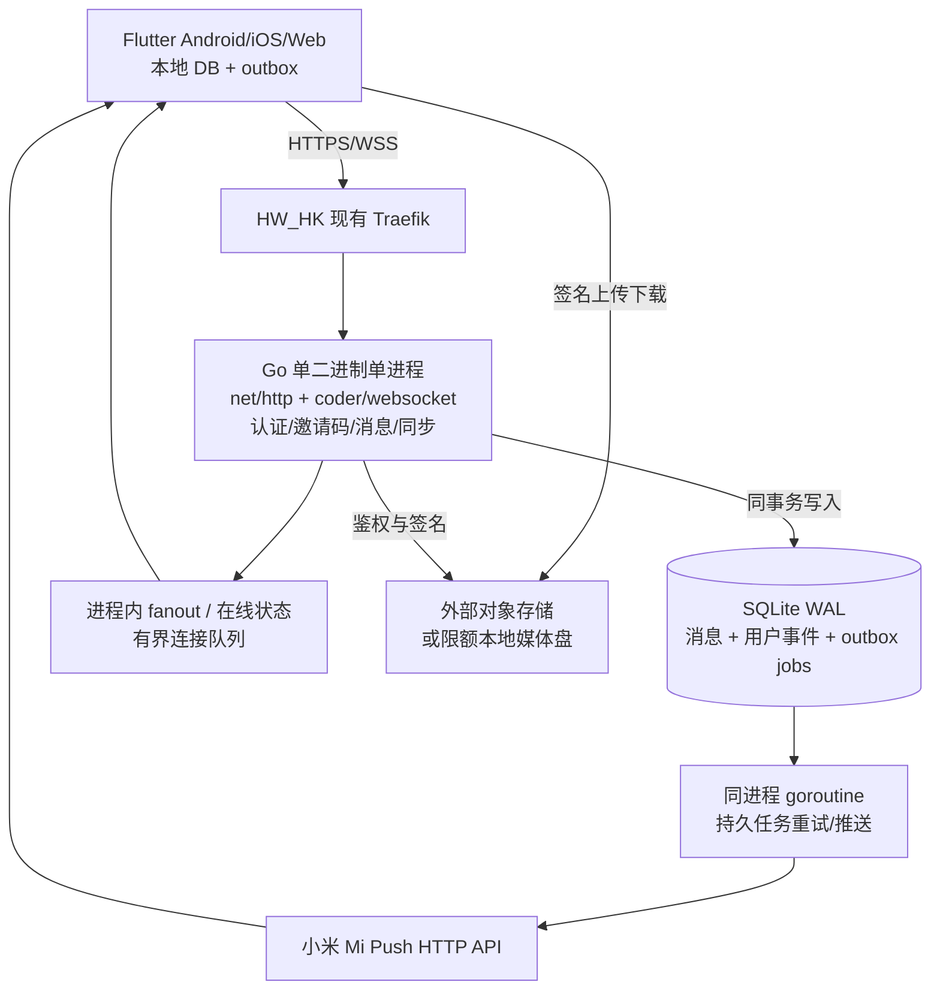

# 「轻聊」（暂名）设计方案

2026-11-10 / Asia/Shanghai。名字仅作设计占位；不是 Telegram 第三方客户端，不使用 Telegram 账号或服务器。研究阶段，不承诺已实现下述功能。

## 1. 产品定位与分期

目标：先服务个人/朋友的小圈子，原生手感、消息可靠、通知可解释。中心化、Go 单二进制自建后端，不用 Matrix，也不重新发明 MTProto。用户已确定：部署 HW_HK，经现有 Traefik；邀请码注册；小米推送优先；v1 不做 E2EE。新加坡机器无公网 IP，不作为部署目标。优先 Android，保留 iOS/Web 能力。

| 阶段 | 范围 | 出口条件 |
|---|---|---|
| P0 动效实验 | 深色聊天列表、滑动进入/返回、文字飞入、滑动回复、长按反应、粒子、typing、原创 Lottie 面板；合成演示数据 | 可交互且明确“本地演示”；无伪造连接/在线状态；profile 不是仅截图 |
| P1a 消息内核 | 邀请制账号、登录/设备撤销、1v1、小群、文字、图片、语音、回复、已读、在线状态、离线补齐、基础多设备事件游标 | 两台设备断网/重启后无丢消息、无重复；媒体权限/群成员权限测试通过 |
| P1b 可用内测 | Android 推送、iOS 适配准备、TG 风格核心动效、Lottie 贴纸、消息静音、屏蔽/举报、设置/缓存管理 | 指定机型后台/锁屏测试；上线前安全检查、备份恢复测试；有明确剩余缺陷 |
| P2 完整社交 | 频道、搜索/编辑/撤回完善、自定义 emoji、成员权限、管理后台、完整多端历史/草稿/设置同步 | 服务端与客户端版本兼容、权限与滥用治理可用 |
| P3 安全/实时媒体 | E2EE 独立设计评审、密钥/设备验证和恢复；语音/视频通话、TURN、通话推送 | 使用成熟协议/库并安全评估，不自创密码协议；测通 NAT/后台/弱网 |

“多设备同步后做”不是先把协议做成无序：P1 必须有 device_id、幂等键、事件游标，至少支持重连和安装恢复；完整多设备历史策略、草稿/通知协调属于后续。

**P1 不做**：公开万人群、全网搜索陌生人、支付、通讯录静默上传、视频号、机器人平台、联邦互通、音视频通话、承诺端到端加密。P1 是 TLS/WSS 的云端聊天：服务端可访问内容，应明确告知，不宣传“与 TG 同级安全”。

## 2. 客户端体验与视觉

- 暗色：背景 #0E1621、面板 #17212B、收到气泡 #182533、发出气泡 #2B5278、主文字 #EEF4FA、次文字 #7D91A5、强调 #5DADE6。参考 Telegram 暗色，不照搬品牌图形。
- 手机单栏；大屏会话侧栏约 320–360 逻辑像素（项目建议），右侧聊天。头像使用原创几何/首字母；不从真实联系人盗用头像。
- 核心：聊天列表→聊天→输入→回复/反应；搜索和菜单第二优先级；不做“控制台式功能大拼盘”。
- 气泡按文本长度自然宽高；图片预留尺寸；时间与状态占位固定，避免确认后跳动。
- 快捷键：Enter 发送，Shift+Enter 换行，Esc 关闭面板/菜单再返回；键盘可达，触屏有按钮替代手势。
- 无障碍：大字、屏幕阅读器语义、Reduce Motion、反应文本标签、触控目标；长按不是唯一操作入口。

## 3. 技术栈与架构

### 已确定的精简技术栈

| 层 | 选择 | 理由/限制 |
|---|---|---|
| 客户端 | Flutter + 局部状态管理，移动 Drift/SQLite | 复用经验与业务逻辑；Web 存储需单独适配；P0 已有纯本地 Flutter Web 原型 |
| 动效 | AnimationController / Overlay / CustomPainter + lottie | 可中断几何过渡；原创 CC0 Lottie，Rive 仅后期有交互角色再引入 |
| API | **Go net/http + 标准库 ServeMux** | 单静态二进制，不加 Echo/Gin 等非必要层；结构化日志用 log/slog |
| WebSocket | **github.com/coder/websocket** | context 支持、wsjson、超时/关闭握手；限制读大小和每连接缓冲；不用多个 WS 库混搭 |
| 数据库 | **database/sql + modernc.org/sqlite** | 无 CGO，CGO_ENABLED=0 便于静态构建；手写参数化 SQL + 嵌入迁移，初期无 ORM。sqlc 可后续在构建期生成代码，不增加运行时服务 |
| SQLite 并发 | WAL + 单写者队列 | 初期 SetMaxOpenConns(1) 简单可靠；事务短小、不得在事务中调用外部推送。读池需明确需求后再开，并逐连接应用 PRAGMA |
| 实时/任务 | 单进程内连接表、fanout、定时 outbox 消费 goroutine | **outbox 任务持久化在 SQLite**，内存仅队列唤醒/连接路由；崩溃后能恢复。不是仅放内存后声称可靠 |
| 推送 | **Mi Push HTTP API，Go net/http 封装小适配器** | 包名/签名/私信 channel 和模板资格需申请；保留 provider 接口；密钥仅服务端。前台服务可选降级，非保证送达 |
| 媒体 | 优先外部 S3 兼容对象存储 | 小图/短语音也不缓存在进程；本地盘备用需总量/单文件/每日上传限额与清理。v1 不在 HK 做重转码 |
| 发布 | Go 静态二进制 + scratch/distroless static nonroot + Compose + 现有 Traefik | 不另起 PostgreSQL/Redis/独立 worker/Nginx/监控全家桶；客户端静态资源可 embed 或直接由同一 Go 服务提供 |

[mattn/go-sqlite3](https://pkg.go.dev/github.com/mattn/go-sqlite3) 需要 CGO，是备选而非当前方案；若 modernc 的实测内存/性能不满足目标，可专门比较，不能假定纯 Go 一定最省内存。固定 Go/依赖版本，按所选 modernc 版本的 go.mod 选择兼容工具链，不盲目复制最新版本号。

[VoceChat](https://voce.chat/) 可作为单服务/SQLite/简单部署的参照，不直接 fork 或照搬许可不明代码。官网当前称服务端包小于 20MB；历史“约15MB”不是本项目二进制大小，也不是运行 RSS。语言选择 Go 并不自动保证 20MB 内存。

[源码/文档参考](https://pkg.go.dev/github.com/coder/websocket)、[modernc SQLite](https://pkg.go.dev/modernc.org/sqlite)、[Go GOMEMLIMIT](https://pkg.go.dev/runtime#hdr-Environment_Variables)。



只运行一个服务实例；内存连接表与 SQLite 本地盘不支持直接横向扩容。需要扩容时另行设计，不在目前约190MB余量的机器上提前加 Redis。AI 后续采用外部接口且必须用户开启，不能在 HK 本机运行模型或放进消息持久化关键路径。

## 4. 消息协议 v1

JSON 起步，可观察易调试；无实测需要前不切 protobuf。所有帧带 v/op/req_id，时间使用 UTC RFC3339，界面转换为用户时区（当前 Asia/Shanghai）。大文件另走 HTTPS。

### 身份与鉴权

- HTTPS 登录得短期 access token，refresh token 可撤销/轮换；移动保存在 Keychain/Keystore。
- Web 优先同源 HttpOnly/Secure/SameSite Cookie，WebSocket 握手检查 Origin；或 HTTPS 换一次性短时 WS ticket。不要把长期 token 放 URL 查询串造成日志泄漏。
- 会话订阅、发消息、读历史、媒体签名每次验证成员权限。不接受客户端自报 sender_id。
- req_id/client_msg_id 均为客户端唯一 ID；服务端生成权威 msg_id、conversation_seq、event_seq。

### 发送与服务端 ACK（示例数据）

```json
{"v":1,"op":"message.send","req_id":"r1","client_msg_id":"uuid-client-1","conversation_id":"c1","payload":{"kind":"text","text":"一起做个流畅的聊天工具","reply_to":null}}
```

服务器事务：检查成员/限流/载荷 → 在 SQLite 写事务（BEGIN IMMEDIATE）中原子递增会话计数器 → 写消息 + 用户事件 + outbox → COMMIT → 返回 ACK。只有持久化成功才称已发送。

```json
{"v":1,"op":"message.ack","req_id":"r1","client_msg_id":"uuid-client-1","msg_id":"m1","conversation_id":"c1","conversation_seq":42,"status":"stored"}
```

唯一约束 `(sender_user_id, client_msg_id)`；重试同 ID 返回同一消息 ACK；同 ID 不同 payload 返回冲突，不悄悄改写。ACK 丢失后重发不得产生第二条消息。顺序以 conversation_seq 为准，不以本地时间为准。

### 推送事件与离线补齐

```json
{"v":1,"op":"event","event_seq":107,"type":"message.created","conversation_id":"c1","conversation_seq":42,"data":{"msg_id":"m1","client_msg_id":"uuid-client-1","kind":"text","text":"一起做个流畅的聊天工具"}}
{"v":1,"op":"event.ack","last_persisted_event_seq":107}
```

- conversation_seq 是会话内顺序；event_seq 是**当前用户的持久事件流**游标，作用不同。每个设备保存自己的 last_persisted_event_seq；成功写本地数据库后才 ACK。
- 登录/重连 `sync.resume(after_event_seq)`，服务端按序分页，并返回 next_cursor/has_more/high_watermark；客户端先补齐到边界，再接后续实时流，或把两者统一为同一有序流，防补齐与订阅间隙丢事件。
- 事件至少包含 message.created/edited/deleted、membership.changed、read.updated；事件过期则明确 `sync.reset_required`，返回会话快照和分页历史，不能假装已完整同步。
- 重复事件按 event_seq/msg_id 幂等 upsert；乱序缓存并请求缺口。读消息时检测 conversation_seq 缺口，但须区分无权限历史/已删除 tombstone，不越权补历史。
- 重连指数退避+随机抖动；网络恢复可立即尝试。心跳初始 25–30 秒（建议值，按代理/系统实测调整），不把心跳当精准在线证据。
- 慢消费者设置每连接队列上限，超限断开并要求补齐；不无限堆内存。

### 状态语义

`pending_local → uploading（附件）→ sending → stored → delivered → read`；失败可手动重试。

- stored：服务端持久化；delivered：至少一个接收设备已持久化确认；read：接收者可见阅读位置上报。
- 推送渠道成功不等于 delivered/read。
- 群聊不把一个人读了当全员读了；按成员 last_read_seq 聚合，避免每条消息保存全员重复行。
- read 更新取 max，不能倒退；静音/隐私设置允许关闭已读展示，服务端策略一致。
- typing/presence 为临时事件，建议 typing 5 秒 TTL、约 2 秒限频（设计值）；presence 聚合多个连接，断线后超时失效，不作为持久承诺。

### 媒体

1. 客户端申请上传，服务端校验类型/大小/配额并发短期签名；2. 直传对象存储；3. finalize 验证实际对象/元数据；4. 发送 media_id。

拒绝任意服务器抓 URL（防 SSRF）；MIME 不只信扩展名；图片去 EXIF（可配置）、超大像素/解压炸弹/恶意 SVG 与病毒检查；附件下载再鉴权。语音兼容格式要在 iOS/Android/Web 实测，优先成熟编码器，不假设每端原生支持同一容器。取消录音/上传生成孤儿定期清理。

## 5. 数据模型

| 表 | 关键字段/约束 |
|---|---|
| invite_codes | code_hash 唯一、created_by、expires_at、max_uses、used_count、revoked_at；注册时在同事务中核销，原始邀请码不入日志 |
| users | id、handle 唯一、display_name、avatar_media_id、password_hash（若密码登录）、created_at、disabled_at |
| devices | id、user_id、platform、push_provider、push_endpoint（受保护）、last_seen、revoked_at |
| sessions | id、device_id、refresh_token_hash、expires_at、revoked_at；不存明文长期 token |
| conversations | id、type direct/group、title、last_seq、created_by；direct pair 唯一规则 |
| members | conversation_id+user_id 主键、role、joined_seq、left_seq、last_read_seq、muted_until |
| messages | id、conversation_id、conversation_seq 唯一、sender_id、client_msg_id、kind、body_json、reply_to、created_at、edited_at、deleted_at；sender/client_id 唯一 |
| user_events | user_id+event_seq 主键、type、payload、created_at；定义保留期与 reset 协议 |
| device_cursors | device_id 主键、last_persisted_event_seq；大群/大历史不能每次全量同步 |
| media | id、owner_id、object_key、mime、bytes、width/height/duration、sha256、status |
| message_media | msg_id、media_id；授权来自会话和媒体状态 |
| reactions | msg_id+user_id+emoji_id 唯一（是否允许多种反应由产品定义） |
| outbox_jobs | id、kind、payload、attempts、next_attempt_at、lease_until、completed_at；重试/死信/监控 |
| sticker_packs/items | id、license、author、source_url、hash、format、poster_media_id；许可可追溯 |

索引：messages(conversation_id, conversation_seq DESC)、user_events(user_id,event_seq)、members(user_id)、outbox_jobs(next_attempt_at) 部分索引。群成员变更和对应历史可见范围要事务一致；编辑/撤回保留 tombstone，客户端已缓存历史通过事件修正。首次内测也要定义删除/保留/备份政策。

## 6. 动效规格（项目草案，不是声称 TG 实测）

来源标签：A1 = Android ChatListItemAnimator；A2 = Android ActionBarLayout；I1 = iOS ContainedViewLayoutTransition，完整来源见 research.md。

| 交互 | 拟定时长/阈值 | 曲线/方式 | 备注与来源边界 |
|---|---|---|---|
| 列表→会话 | 手机 240ms | cubic(0.33,0.52,0.25,0.99)，右→左；背景轻视差 | 240 为本项目估计；曲线来自 I1，但此时长不是 I1 统一规定。Android 默认路径 A2 另有 150ms，不冒充相同 |
| swipe-back | 拖动无固定时长，收尾约 120–240ms | 跟手线性，释放按速度/剩余距离 | 设计完成阈值 30% 或明显快速甩动；不是照抄 A2 全部分支。边缘优先返回 |
| 文字发送 | 250ms | cubic(0.1992,0.0106,0.2792,0.9103) 的近似 | A1 默认值/曲线作为参考；overlay 从输入区到目标框，文字自身可分进度。长文本可降级淡入 |
| 滑动回复 | 拖动直接控制，回弹约 220ms | 阻尼位移 + SpringSimulation | 本项目估计阈值 64 逻辑像素、最大 88；初始 spring mass1/stiffness350/damping30 为待真机调参，不是 TG 参数 |
| 长按菜单 | 触发 420ms，出现 180ms | easeOut + 0.96→1；局部模糊/遮罩 | 全部本项目建议；手势移动>8px 取消长按；保留右键/按钮入口 |
| 反应条 | 180ms | 小幅 spring/顺序入场 | 本项目建议；不抢消息列表滚动 |
| 反应 burst | 600ms | easeOut 径向粒子+透明衰减 | 本项目建议；限并发，Reduce Motion 只更新 badge |
| 回到底部按钮 | 出入 160ms，点击滚动≤260ms | fade/scale + easeOut | 本项目建议；距离很远直接定位最近页 |
| typing | 900ms 循环，3 点错峰 | sine 位移/透明度 | 本项目建议；离屏暂停，5秒无事件过期 |
| 录音进入/锁定 | 180/220ms | easeOut/轻 spring | 本项目建议；锁定阈值上移72px、取消左移96px；真机调参 |
| 表情面板 | 240ms | 与键盘 inset 同步，不双重 padding | 本项目建议；输入法真实时长优先；预取最近使用 |
| 贴纸播放 | 按资源 fps；TGS 60fps规范 | 播放器时钟/可见性 | 60 来自官方素材规范，不是设备可保证帧率；低端限同时播放 |
| 媒体打开/关闭 | 240ms / 跟手+220ms回弹 | 缩略图共享几何、缩放手势 | 本项目建议；pinch 状态不触发关闭 |
| 主题切换 | 220ms | 色值插值 | 本项目建议；避免动态壁纸同时触发大面积重绘 |

## 7. HW_HK 部署与资源规划（设计，不执行部署）

用户决定部署香港 HW_HK（2 核 1G），沿用现有 Traefik。新加坡无公网 IP，不迁移过去。约190MB可用、RSS 应用约62MB均为既有上下文，非本次重新测量。**可用内存不等于可把190MB全部用满**，上线前仍要测系统、Traefik、RSS 应用峰值和磁盘。

### 内存目标，而非测试结果

- Go+SQLite 单服务在空闲/少量连接下，**RSS 目标20–40MiB**，不是承诺。二进制大小、Go HeapAlloc、进程 RSS、cgroup memory.current 四者不同。
- 初始预算估计：运行时代码/栈/基础堆约10–20MiB，SQLite 页缓存约2–4MiB，少量 WS/JSON/HTTP 缓冲约4–12MiB，推送/短任务等余量约4–8MiB。区间可重叠、不可机械相加当实测，实际需冷启动/稳态/突发测试。
- SQLite 初始 `cache_size=-2048`（每连接约2MiB）、`mmap_size=0`、`busy_timeout=5000`、`foreign_keys=ON`、`journal_mode=WAL`；使用 `synchronous=FULL` 优先持久性，确认延迟后再讨论降级。限制长读事务并 checkpoint，防 WAL 膨胀。
- 每连接 outbound 队列限32个小事件、帧最大64KiB（草案）；限制并发上传、JSON body、最大在线连接数，超过阈值拒绝或要求重连补齐，不能无限积压。
- Go 初始 `GOMEMLIMIT=48MiB`、`GOGC=75`（待压测）。GOMEMLIMIT 是运行时软限制，不等于 RSS 硬上限，也不能限制所有文件页缓存/外部分配。初始容器硬限96MiB、reservation32MiB；会 OOM 就缩功能/连接预算，不静默加到整机满。
- 因现有服务峰值未知，先测整机健康，再批准上线。重负载（图片解码、缩略图转码、反病毒大进程）不得直接塞这台机器。静态客户端/字体/CanvasKit 大文件走磁盘或 CDN，不整包常驻内存。

### 单二进制镜像与 Compose 草案

构建在 box/CI 完成，`CGO_ENABLED=0 go build -trimpath -ldflags='-s -w'`；最终镜像优先 distroless/static:nonroot（锁digest）；scratch 方案需复制 CA 证书，提供 writable 数据目录，Go 服务内部实现健康检查子命令，不依赖镜像有 curl/shell。

```yaml
services:
  chat:
    image: light-chat:<固定版本>
    restart: unless-stopped
    user: "65532:65532"
    read_only: true
    mem_limit: 96m
    mem_reservation: 32m
    cpus: 0.50
    pids_limit: 96
    environment:
      GOMEMLIMIT: 48MiB
      GOGC: "75"
      CHAT_DB: /data/chat.sqlite
    volumes:
      - ./data:/data
      - ./secrets:/run/secrets:ro
    tmpfs:
      - /tmp:size=8m,mode=1777
    networks: [traefik-existing]
    # labels 在读取实际 Traefik 网络/entrypoint/resolver 后填写。
    # 不发布 ports；内部服务监听0.0.0.0:8080，由现有Traefik路由。
networks:
  traefik-existing:
    external: true
    name: <读取现有网络名后填写>
```

这是不可直接运行的草案，域名/网络/证书解析器未确认，绝不擅自改 Traefik。WS 握手 Origin/认证/代理空闲超时与客户端心跳一起测试。容器内权限、目录 UID、只读根目录、secrets 读取方式也要验收。

### 注册、推送与可靠性

- **仅邀请码注册**：服务端生成高熵码，存 hash；过期/次数/撤销/创建人明确，限流防猜；核销与创建账号同事务，防并发超发。
- 小米 Mi Push 优先：先确认开发者主体、package/signature、私信 channel/模板申请资格；2026 年底规则按 research.md 核实。推送默认只传最少元数据/可配置预览，不泄露私聊全文。
- 前台服务由用户主动开启，显示常驻通知并说明耗电；不能承诺强行停止后还能通知。其他机型、iOS APNs/Web Push 放后续，v1 明确兼容范围。
- 进程内 outbox goroutine 从 **SQLite 持久表**领取任务，超时 lease/重试/去重；服务崩溃后扫描恢复，不靠内存保存待推送任务。
- 备份用 SQLite online backup API 或维护窗口停服务一致性复制；**不能只复制活跃中的 .sqlite 而漏 WAL**。备份包含附件引用/服务端必要密钥，异地加密存储，定期恢复演练。
- 指标先用现有日志与低成本端点：RSS/cgroup内存、goroutine、活跃 WS、ACK 延迟、outbox年龄、SQLite busy/WAL大小、磁盘/通知失败；pprof 仅内部临时开启，绝不公网暴露。
- 公网发布前确认隐私政策、内容治理、分发与当地合规；香港托管不意味着免除责任。

## 8. 验收与风险清单

### 消息正确性
- ACK 前后断网、服务重启、重复提交、乱序/缺口、游标过期、成员退群/踢出、历史越权、附件失败、跨设备读游标。
- 群事务并发分配 seq 不重复；commit 前不 ACK；outbox 投递失败可以重试；广播丢失靠持久同步修复。
- 所有 UI“已发送/已读”有严格语义，绝不模拟真实服务状态。

### 手感
- 真机快速开关会话、长文本、20 次连续发送、图片高度变化、滚动中收消息、emoji+文字混排、中英文输入法、手势取消、多指、旋转、桌面缩放。
- 低端档+60/120Hz；profile/release 测，而不是 debug 主观感觉；记录设备/OS/构建版本再报告数字。

### 安全
- 成员与媒体鉴权、限流/反滥用、Web XSS/CSRF/Origin、密码/刷新令牌、上传检查、设备撤销、日志隐私、备份恢复。
- E2EE 以后用成熟方案并评审迁移/多设备密钥；API 预留字段不等于已经支持安全加密。

## 9. 已确定与剩余确认

已确定：HW_HK + 现有 Traefik；Go 单二进制 + SQLite WAL；无 PG/Redis/外部 worker；邀请码；小米优先+可选常驻；E2EE v1不做，后续评审。

仍需确认：
1. 主力小米型号/系统版本，目标内测人数和群大小。
2. 品牌名称/域名、是否 Android 优先，iOS/Web 的正式优先级。
3. 小米推送主体/应用资格与签名条件；对象存储选择/流量预算。
4. 媒体保留期与磁盘上限、服务器可读聊天的隐私说明。
5. 真正上线前单独授权部署；本阶段未碰服务器，所有内存数字为预算目标。
